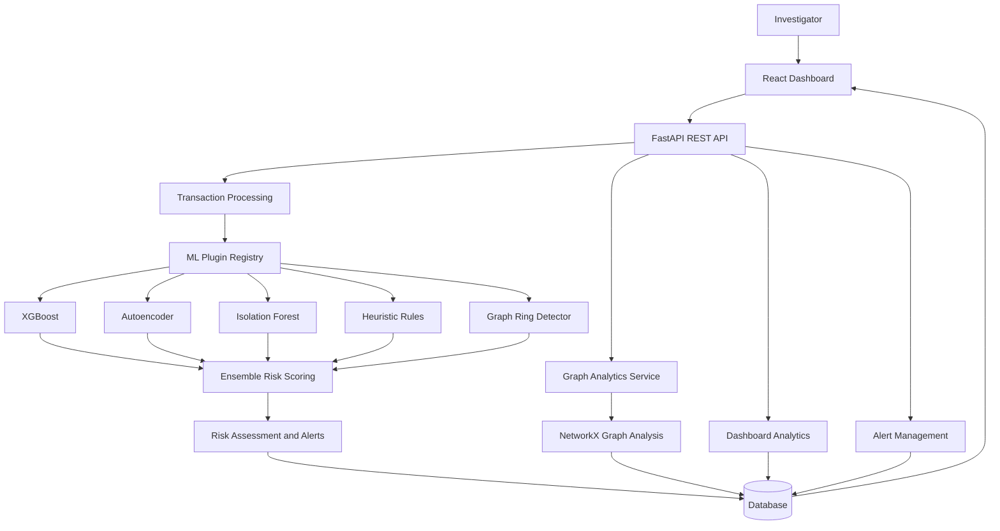

# Enhancing Anti-Money Laundering Detection Through Machine Learning and Graph-Based Analytics

<p align="center">
  <strong>An Intelligent AML Detection and Investigation Platform</strong>
</p>

<p align="center">
  Machine Learning | Graph Analytics | FastAPI | React | PostgreSQL
</p>

---

## 📌 Project Overview

Money laundering is a serious financial crime in which illegally obtained money is transferred through complex financial transactions to conceal its original source.

Traditional rule-based systems often struggle to identify complex transaction patterns, suspicious account relationships, and previously unseen fraudulent activities.

This project presents an intelligent **Anti-Money Laundering (AML) Detection System** that combines Machine Learning, anomaly detection, and graph-based analytics to identify potentially suspicious financial transactions.

The system analyzes transaction behavior, assigns risk scores, identifies suspicious account relationships, and provides an interactive dashboard for investigators to examine alerts and transaction networks.

## 🎯 Problem Statement

Traditional AML detection systems primarily depend on predefined rules and transaction thresholds. These approaches may fail to detect sophisticated money laundering techniques such as:

- Structuring and smurfing.
- Circular money transfers.
- Multi-layered transaction flows.
- Suspicious account relationships.
- Unusual transaction amounts and patterns.
- Previously unseen anomalous activities.

The objective of this project is to develop an intelligent detection platform that combines multiple analytical techniques to improve suspicious transaction identification and investigation.

## ✨ Key Features

- **Machine Learning-Based Detection:** Combines supervised and unsupervised approaches to identify suspicious transaction patterns.
- **Ensemble Risk Scoring:** Combines predictions from multiple detection plugins into a unified risk assessment.
- **Graph-Based Analytics:** Examines relationships between accounts and transaction flows.
- **Circular Transaction Detection:** Identifies potential circular money movement patterns.
- **Anomaly Detection:** Detects unusual transaction behavior.
- **SHAP-Based Explainability:** Presents feature importance information to help explain risk predictions.
- **Interactive Investigator Dashboard:** Displays transaction statistics, alerts, risk levels, and network visualizations.
- **Alert Management:** Supports investigation statuses such as confirmed fraud, false positive, and under investigation.
- **CSV Transaction Upload:** Supports PaySim-formatted transaction dataset ingestion.
- **Pluggable ML Architecture:** Allows detection models to be enabled, disabled, and reweighted through API endpoints.

## 🧠 Machine Learning Algorithms

The system uses multiple detection plugins:

| Algorithm / Technique | Category | Purpose |
|---|---|---|
| XGBoost Classifier | Supervised Learning | Identifies suspicious transaction patterns |
| Autoencoder | Unsupervised Anomaly Detection | Identifies unusual transaction behavior |
| Isolation Forest | Unsupervised Learning | Detects anomalous transaction outliers |
| Heuristic Rule Engine | Rule-Based Detection | Identifies suspicious transaction indicators |
| Graph Ring Detector | Graph Analytics | Identifies suspicious transaction network patterns |

The individual detection plugins contribute to the overall risk assessment through an ensemble scoring mechanism.

## 🕸️ Graph-Based Analytics

Graph analytics represents financial transactions as a network:

- **Nodes:** Represent customer or merchant accounts.
- **Edges:** Represent financial transactions between accounts.
- **Edge Attributes:** Include transaction amounts and suspicious indicators.

The system uses NetworkX to analyze transaction relationships and identify suspicious network structures.

### Graph Analytics Capabilities

1. **Circular Transaction Detection:** Identifies potential circular fund transfers, such as A → B → C → A.
2. **Multi-Hop Account Analysis:** Examines account relationships across multiple transaction hops.
3. **Structuring Pattern Detection:** Identifies suspicious transaction patterns that may indicate smurfing.
4. **Transaction Flow Visualization:** Displays connected accounts and their financial relationships.
5. **Network Investigation:** Helps investigators explore suspicious account connections.

## 🏗️ System Architecture

The application follows a frontend-backend architecture.



## 🛠️ Technology Stack

### Frontend
- React.js
- Vite
- JavaScript
- Chart.js
- Vis-Network
- Lucide React

### Backend
- Python
- FastAPI
- Uvicorn
- SQLAlchemy

### Machine Learning and Analytics
- XGBoost
- Scikit-learn
- NumPy
- SciPy
- Joblib
- NetworkX

### Database
- PostgreSQL
- SQLite (local development configuration)

### Development and Deployment
- Git
- GitHub
- Docker
- Docker Compose

## 📂 Project Structure

```text
anti_money_laundering-main/
│
├── backend/
│   ├── app/
│   │   ├── api/
│   │   ├── core/
│   │   ├── models/
│   │   ├── ml_plugins/
│   │   ├── schemas/
│   │   └── services/
│   │
│   ├── models/
│   ├── scripts/
│   ├── tests/
│   ├── requirements.txt
│   ├── Dockerfile
│   └── docker-compose.yml
│
├── frontend/
│   ├── src/
│   │   ├── components/
│   │   ├── views/
│   │   └── services/
│   │
│   ├── public/
│   ├── package.json
│   └── vite.config.js
│
├── diagrams/
├── docs/
├── .gitignore
├── Dockerfile
├── document.md
├── documentation.md
└── README.md
```

## ⚙️ Installation and Setup

### Prerequisites

Install the following before running the application:

- Python 3.10 or later
- Node.js and npm
- Git
- PostgreSQL (optional for local SQLite development)
- Docker Desktop (optional)

### 1. Clone the Repository

```bash
git clone https://github.com/chandana468/-anti-money-laundering-ml.git
```

Navigate into the project:

```bash
cd -anti-money-laundering-ml
```

### 2. Backend Setup

Navigate to the backend directory:

```bash
cd backend
```

Create a Python virtual environment:

```bash
python -m venv venv
```

Activate it on Windows:

```powershell
.\venv\Scripts\Activate.ps1
```

Install the required dependencies:

```bash
pip install -r requirements.txt
```

Start the backend API using Uvicorn:

```bash
python -m uvicorn app.main:app --host 127.0.0.1 --port 8000 --reload
```

The backend API will be available at:

```text
http://localhost:8000
```

Interactive API documentation:

```text
http://localhost:8000/docs
```

### 3. Frontend Setup

Open another terminal and navigate to the frontend directory:

```bash
cd frontend
```

Install dependencies:

```bash
npm install
```

Start the development server:

```bash
npm run dev
```

The frontend will be available at:

```text
http://localhost:3000
```

### 4. Database Configuration

The backend uses SQLite as its default local development database configuration.

For production-style deployment, PostgreSQL can be configured through the `DATABASE_URL` environment variable.

The project also includes a Docker Compose configuration for PostgreSQL, the backend API, and pgAdmin.

## 🔌 Important API Endpoints

| Method | Endpoint | Description |
|---|---|---|
| GET | `/api/v1/health` | Checks backend health |
| GET | `/api/v1/ready` | Checks service readiness |
| POST | `/api/v1/transactions/` | Processes a transaction |
| POST | `/api/v1/transactions/bulk` | Processes bulk transactions |
| POST | `/api/v1/transactions/upload-csv` | Uploads transaction CSV data |
| GET | `/api/v1/alerts/` | Retrieves suspicious transaction alerts |
| PATCH | `/api/v1/alerts/{id}` | Updates an alert status |
| GET | `/api/v1/graph/account/{acc_id}` | Retrieves an account transaction graph |
| GET | `/api/v1/graph/cycles` | Detects circular transaction patterns |
| GET | `/api/v1/plugins/` | Lists registered ML plugins |
| GET | `/api/v1/analytics/dashboard-kpis` | Retrieves dashboard KPIs |

For the complete interactive API reference, visit `/docs` after starting the backend.

## 📸 Screenshots

Add screenshots of your actual running application here to help visitors understand the system.

Suggested screenshots:

| Screenshot | Description |
|---|---|
| Dashboard | Overall transaction statistics and risk indicators |
| Alerts | Suspicious transaction alerts and investigation details |
| Graph Analytics | Connected accounts and transaction network |
| ML Model Manager | Registered detection models and their settings |
| Transaction Simulator | Transaction input and risk assessment |

To add screenshots, create a folder named `screenshots` in the project root and insert images using:

```markdown

```

## 🚀 Future Enhancements

- Integration of advanced Graph Neural Networks (GNNs).
- Real-time transaction stream processing.
- Improved model performance evaluation and monitoring.
- Advanced explainable AI techniques.
- Integration with external financial crime intelligence sources.
- Enhanced investigator reporting and visualization.
- Scalable cloud-based deployment.

## 🎓 Academic Project

**Project Title:** Enhancing Anti-Money Laundering Detection Through Machine Learning and Graph-Based Analytics

**Domain:** Artificial Intelligence, Machine Learning, Financial Technology, and Data Analytics

**Project Type:** B.Tech Computer Science and Engineering Major Project

## 👩‍💻 Contributors

Add the names and responsibilities of all project team members here.

## 📜 Disclaimer

This project is developed for academic and research purposes. Its predictions and alerts are intended to assist suspicious transaction analysis and should not be treated as definitive proof of financial crime. Real-world AML deployment requires appropriate validation, regulatory compliance, security controls, and human investigation.

---

<p align="center">
  <strong>Built to explore intelligent financial crime detection through Machine Learning and Graph Analytics.</strong>
</p>
